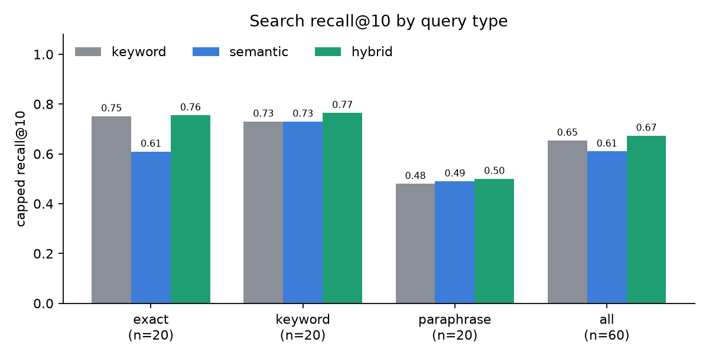
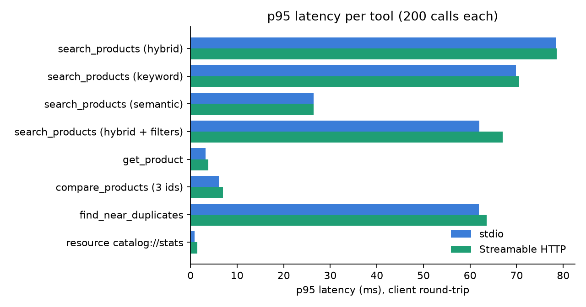

# catalog-mcp

An [MCP](https://modelcontextprotocol.io) server that gives any MCP client (desktop apps, IDEs,
agents) tools to **search, compare and deduplicate products** in a real catalog: 231,578 Amazon
products from the Appliances and Video Games categories of
[Amazon Reviews 2023](https://amazon-reviews-2023.github.io/) (McAuley Lab).

Search is keyword (DuckDB full-text BM25), semantic (sentence-transformers + FAISS) or hybrid
(reciprocal rank fusion of both). The server speaks stdio for desktop clients and Streamable HTTP
with bearer-token auth for remote use. Install it with one command:
`uv tool install git+https://github.com/Yehiak/catalog-mcp`.

## Results

All numbers measured on the full 231,578-product catalog (Windows 11, Python 3.11, RTX 5070 Ti).

| What | Result |
|---|---|
| Scripted client tasks (30 tasks, 45 MCP calls) | **30/30 pass** over stdio and over Streamable HTTP |
| LLM agent tasks: Qwen 3.8 27B (local, Ollama) uses the tools from their descriptions alone | **30/30 tasks**, right first tool 30/30, 38/39 calls accepted |
| MCP Inspector black-box checks (stdio + HTTP, incl. `--strict` schema check) | **21/21 pass** |
| Search recall@10, 60 labeled queries: keyword / semantic / **hybrid** | 0.654 / 0.610 / **0.673** |
| p95 latency, hybrid search (stdio, client round-trip) | **78.5 ms** (80.8 ms with the embedding model on CPU) |
| p95 latency, `get_product` / `compare_products` / `find_near_duplicates` | 3.2 / 6.1 / 61.9 ms |
| Unit and integration tests | 48 pass (offline, ~3 s) |
| Catalog build: load + full-text index + embeddings | 7 s + 14 s + 62 s (GPU); 557 MB DuckDB + 356 MB FAISS |

### Search quality: keyword vs semantic vs hybrid



| Query type | n | Keyword (BM25) | Semantic (bge-small) | Hybrid (RRF) |
|---|---|---|---|---|
| exact (part numbers, product names) | 20 | 0.751 | 0.609 | **0.755** |
| keyword ("dryer lint screen") | 20 | 0.730 | 0.730 | **0.765** |
| paraphrase ("the rubber strip around my fridge door is torn") | 20 | 0.480 | 0.490 | **0.500** |
| all | 60 | 0.654 | 0.610 | **0.673** |

MRR@10 (how high the first relevant hit is): keyword 0.761, semantic 0.782, hybrid **0.811**.

How it is measured: 60 queries in [eval/search_queries.json](eval/search_queries.json), 20 of each
type. Relevance is a SQL rule over structured fields (category path, brand, part numbers in the
title or spec table), written without looking at any retriever's output. The metric is capped
recall@10 = relevant items in the top 10 / min(10, number of relevant items).

What the numbers say:

- **Keyword wins on codes, semantic on descriptions, hybrid is never far behind the better one.**
  Semantic search finds a part number only 61% of the time; BM25 finds it 75% of the time.
- **Paraphrases are hard for everyone** (~0.5). A 33M-parameter embedding model often matches
  the right words but the wrong product type (a fridge *drip tray* for "fridge water tastes like
  chlorine"). A larger embedding model or a reranker is the obvious next step.
- **The eval caught a real bug.** DuckDB's full-text tokenizer drops every non-letter by default,
  so `W10295370A` was indexed as `w a`. Keeping digits and adding a hyphen-free part-number field
  (`DA29-00020B` → `DA2900020B`) raised keyword recall on exact queries from **0.357 to 0.751**,
  and hybrid overall from 0.607 to 0.673.
- Limits: rule-based labels miss relevant items whose title doesn't match the rule, which
  penalises semantic search somewhat. 60 queries is a small set.

### Tool-call success

**Scripted client** ([scripts/eval_client_tasks.py](scripts/eval_client_tasks.py)): 30 tasks that each mirror one
user request. They chain calls (search, then use the returned ids in `get_product` or
`compare_products`) and check the results: filters respected, cheapest really the cheapest,
dedup finds shared part numbers, a PS5 and a Wii U edition of one game flagged as variants,
bad input answered with a clear error. **30/30 over stdio, 30/30 over HTTP.** This suite checks
correctness and guards against regressions. It doesn't test tool choice, because the calls are
hard-coded.

**LLM agent** ([scripts/eval_llm_agent.py](scripts/eval_llm_agent.py)): the harder test. A local Qwen 3.8 27B (Q4_K_M, Ollama,
temperature 0, no thinking) gets only the tool list as the server advertises it, plus 30 requests
in plain English ("Is product B0… also listed by other sellers?", "Compare the top three PS5
controller charging stations and tell me which is best rated"). It has to pick tools, fill in
arguments and answer.

| Metric | Result |
|---|---|
| Task success (programmatic check per task) | **30/30** |
| Right tool on the first call | **30/30** |
| Tool calls accepted by the server | 38/39 (the one error is the task that asks about a non-existent id; the model then told the user it doesn't exist) |
| Mean time per task | 29.6 s |

The tasks are single-intent requests, so 30/30 shows the tool names, descriptions and argument
docs are clear enough for a mid-size open model. It doesn't show the server handles every request
a person might make.

### Latency



200 calls per tool with varied arguments (eval queries, random product ids), timed at the client,
so each number includes the full MCP round-trip.

| Tool | stdio p50 | stdio p95 | HTTP p95 | stdio p95, embeddings on CPU |
|---|---|---|---|---|
| search_products (hybrid) | 63.2 | **78.5** | 78.6 | 80.8 |
| search_products (keyword) | 57.9 | **69.9** | 70.5 | 71.3 |
| search_products (semantic) | 22.3 | **26.4** | 26.4 | 29.4 |
| search_products (hybrid + filters) | 49.8 | **62.0** | 67.0 | 67.6 |
| get_product | 2.6 | **3.2** | 3.8 | 3.3 |
| compare_products (3 ids) | 5.3 | **6.1** | 7.0 | 6.1 |
| find_near_duplicates | 43.3 | **61.9** | 63.6 | 63.0 |
| resource catalog://stats | 0.7 | **0.9** | 1.5 | 1.0 |

(milliseconds)

- **No GPU needed to serve.** Encoding one query with bge-small takes a few ms even on CPU. Most
  of the semantic time is the exact FAISS scan over 231K vectors.
- **BM25 dominates hybrid.** DuckDB scores the query against every document. Hybrid runs keyword
  and semantic search in parallel threads, which cut its p95 from 86 ms to 74 ms in an A/B run on
  the same build.
- **Filters make search faster.** Filters narrow the candidates before ranking: a cached FAISS
  `IDSelector` on the vector side and a SQL `WHERE` on the BM25 side.
- **HTTP costs about the same as stdio** on localhost: 0–5 ms more, within run-to-run noise.

## Install and use

You need Python 3.11+ and [uv](https://docs.astral.sh/uv/).

```bash
# 1. Install the catalog-mcp command from GitHub (downloads torch the first time: a few minutes).
uv tool install git+https://github.com/Yehiak/catalog-mcp

# 2. Build the catalog once: downloads ~720 MB of metadata and the embedding model,
#    then loads DuckDB and builds the indexes (~90 s on a GPU, longer on CPU).
catalog-mcp build

# Smaller or different catalog: any category of the dataset works.
catalog-mcp build --categories Video_Games

# 3. Check what was built.
catalog-mcp stats
```

The catalog goes to your user data directory. Set `CATALOG_MCP_HOME` or pass `--data-dir` to put
it somewhere else. The embedding model is cached by Hugging Face (`HF_HOME`). To update later, run
`uv tool upgrade catalog-mcp`. To run it without installing, use
`uvx --from git+https://github.com/Yehiak/catalog-mcp catalog-mcp`.

### Desktop clients (stdio)

The client starts the server as a subprocess. Add this to your client's MCP config (Claude
Desktop's `claude_desktop_config.json`, Cursor's `mcp.json`, ...):

```json
{
  "mcpServers": {
    "catalog": {
      "command": "catalog-mcp",
      "env": { "CATALOG_MCP_HOME": "/path/to/catalog" }
    }
  }
}
```

`env` is only needed if you built the catalog somewhere other than the default location.
VS Code (`.vscode/mcp.json`) uses `"servers"` instead of `"mcpServers"` and needs
`"type": "stdio"` in the entry.

### Remote use (Streamable HTTP + token)

```bash
export CATALOG_MCP_TOKEN=$(catalog-mcp token)
catalog-mcp serve --transport http --host 0.0.0.0 --port 8000
```

Every request must send `Authorization: Bearer <token>`, except `GET /healthz`. The server
refuses to start over HTTP without a token, unless you pass `--no-auth` on a loopback address.
On localhost it also turns on the SDK's DNS-rebinding protection. Client config for remote servers:

```json
{
  "mcpServers": {
    "catalog": {
      "type": "http",
      "url": "https://your-host:8000/mcp",
      "headers": { "Authorization": "Bearer <token>" }
    }
  }
}
```

Use TLS (a reverse proxy) for anything beyond your own machine. The token is one shared secret,
compared in constant time. For multi-user access, put the server behind a gateway that does OAuth.

### Docker

```bash
docker build -t catalog-mcp .
docker run --rm -v catalog-data:/data catalog-mcp build            # one-time catalog build (CPU)
docker run --rm -p 8000:8000 -v catalog-data:/data \
  -e CATALOG_MCP_TOKEN=<token> catalog-mcp                          # serves http://localhost:8000/mcp
```

The image uses CPU-only torch and already contains the embedding model and the DuckDB FTS
extension, so serving needs no downloads. Building the full catalog on CPU is slow: embedding is
the expensive step, and the 62 s GPU build becomes a long job. A faster route is to build on a
machine with a GPU (`catalog-mcp build --data-dir ./catalog`) and mount that folder:
`-v ./catalog:/data`.

### From Python

```python
import asyncio
from catalog_mcp.client import stdio_client

async def main():
    async with stdio_client() as client:
        r = await client.call_tool("search_products", {"query": "countertop ice maker", "max_price": 150})
        for p in r.structured_content["results"]:
            print(p["product_id"], p["price"], p["title"][:60])

asyncio.run(main())
```

### Inspect it

```bash
npx @modelcontextprotocol/inspector catalog-mcp     # opens the Inspector UI
```

## What the server exposes

MCP servers offer three kinds of things, and each one is controlled by a different party:

| Kind | Controlled by | What it is here |
|---|---|---|
| **Tools** | the model, which decides when to call them | `search_products`, `get_product`, `compare_products`, `find_near_duplicates` |
| **Resources** | the application, which fetches them by URI and puts them in context | `catalog://stats`, `catalog://categories/{category}/stats` |
| **Prompts** | the user, who picks them (often as a slash command) | `write_product_comparison` |

### Tools

All four are read-only (`readOnlyHint: true`). They have strict input schemas: unknown arguments
are rejected, so a typo like `max_prise` is an error instead of a silently ignored filter. Each
tool also has a typed output schema, and results come back as `structuredContent` with a JSON text
copy for text-only clients.

| Tool | Input | Output |
|---|---|---|
| `search_products` | `query`, `mode` (hybrid / semantic / keyword), `limit` 1–50, filters: `category`, `brand`, `min_price`, `max_price`, `min_rating` | ranked hits with id, title, brand, price, rating, score |
| `get_product` | `product_id`, `max_description_chars` | features, description, category path, spec table, image URL |
| `compare_products` | 2–6 distinct `product_ids`, `max_specs` | aligned spec table (core fields + every spec at least two products list), `cheapest_id`, `best_rated_id` (rating shrunk toward 4.0 by count, so 5.0 from 2 ratings doesn't win), `most_reviewed_id` |
| `find_near_duplicates` | `product_id` **or** a draft `title`, `min_similarity`, `limit`, `same_category` | candidates with the evidence: cosine similarity, title overlap, shared part numbers, same store, platform conflict, and a verdict: `likely_duplicate` / `possible_duplicate` / `variant` |

Errors the model can fix come back as tool errors with a hint, for example `Unknown category 'Books'. Loaded categories: Appliances, Video_Games.` or `No product with id … Use search_products to find valid ids.`

### Resources and prompt

- `catalog://stats`: dataset, products per category, embedding model, build time.
- `catalog://categories/{category}/stats`: a URI template with price percentiles, rating histogram, top brands and top subcategories.
- `write_product_comparison(product_ids, audience, length)`: renders instructions to call
  `compare_products`, fetch missing specs with `get_product`, and write a verdict-first
  comparison that uses only facts from the tools.

### Transports

- **stdio**: the client launches `catalog-mcp` and exchanges JSON-RPC over stdin/stdout. No
  network and no auth needed; this is what desktop clients use. All logging goes to stderr,
  because stdout belongs to the protocol.
- **Streamable HTTP**: one endpoint (`/mcp`) that takes JSON-RPC over POST and can stream
  responses. This is what remote clients use, so it sits behind the token middleware.

## Architecture

```
                     MCP client (desktop app, IDE, agent)
                          │ stdio            │ Streamable HTTP
                          ▼                  ▼
               ┌─────────────────────────────────────────┐
               │ cli.py     serve / build / stats / token │
               │ auth.py    bearer-token ASGI middleware  │
               │ server.py  MCPServer: 4 tools,           │
               │            2 resources, 1 prompt         │
               │ models.py  Pydantic output schemas       │
               └───────────────────┬─────────────────────┘
                                   ▼
               ┌─────────────────────────────────────────┐
               │ catalog.py  keyword │ semantic │ hybrid  │
               │             compare · near-duplicates   │
               └──────┬──────────────────────┬───────────┘
                      ▼                      ▼
        DuckDB: products table +     FAISS IndexFlatIP (384-d, cosine)
        BM25 full-text index         ◄── bge-small-en-v1.5 query encoder
                      ▲                      ▲
                      └──── ingest.py ───────┘
            Hugging Face JSONL → clean → DuckDB + FTS → embeddings → FAISS
```

```
src/catalog_mcp/
  config.py    paths (CATALOG_MCP_HOME / user data dir), dataset and model defaults
  ingest.py    download, load JSONL into DuckDB, part-number field, BM25 index, embeddings, FAISS
  embed.py     sentence-transformers wrapper (lazy, offline-first), FAISS helpers
  catalog.py   search modes, filters, lookups, comparison, near-duplicate scoring, stats
  models.py    Pydantic output schemas
  server.py    MCP tools, resources, prompt; strict argument validation
  auth.py      bearer-token middleware for HTTP
  client.py    stdio / HTTP client helpers (tests, scripts, your own code)
  cli.py       catalog-mcp command
scripts/
  eval_search.py        recall@10 + MRR@10 for keyword / semantic / hybrid -> docs/
  eval_client_tasks.py  30 scripted client tasks over stdio or HTTP
  eval_llm_agent.py     30 natural-language tasks solved by a local LLM through the tools
  bench_latency.py      p50/p95/p99 per tool over stdio and HTTP -> docs/
  inspector_check.py    MCP Inspector CLI black-box checks over stdio and HTTP
eval/search_queries.json  labeled search queries (SQL relevance rules)
tests/                    48 tests: catalog logic, every tool through an MCP client, both transports, auth
```

## Design notes

- **One process, two stores, one key.** Rows live in DuckDB; vectors live in FAISS at position
  `vec_id`, a dense 0..n-1 column in the products table. Filtered semantic search turns the SQL
  filter into a FAISS `IDSelector` (cached per filter), so filtering happens inside the search:
  nothing is over-fetched and dropped afterwards.
- **Hybrid = reciprocal rank fusion** of the top 50 from each retriever (k = 60). It uses ranks,
  not raw scores, so BM25 and cosine values never have to be put on the same scale.
- **Near-duplicates are explained, not just scored.** Embedding similarity alone can't tell
  "same filter, different seller" from "same game, different console". Shared part numbers
  (normalised, units like `1500W` excluded) upgrade a candidate to `likely_duplicate`; different
  gaming platforms in the titles downgrade it to `variant`. All of this evidence is in the output.
- **Fast start for stdio clients.** The catalog opens on the first call and the embedding model
  warms up in a background thread, so `tools/list` answers right away. The model loads from the
  local cache without a network round-trip when it's already there.
- **Thread safety.** The SDK runs sync tools in worker threads, so each thread gets its own
  DuckDB cursor.
- **Build is atomic.** Everything is written to temporary files and swapped in only when the whole
  pipeline has succeeded. Cleaning happens in a TEMP table, so the DuckDB file has no dead blocks
  (1.55 GB → 557 MB).

## Reproduce

```bash
uv sync                                           # dev setup (CUDA 12.8 torch on Windows/Linux)
uv run pytest -q                                  # 48 tests, offline, ~3 s
uv run catalog-mcp build --data-dir data          # full catalog
uv run python scripts/eval_search.py --data-dir data
uv run python scripts/eval_client_tasks.py --data-dir data
uv run python scripts/bench_latency.py --data-dir data --calls 200
uv run python scripts/inspector_check.py --data-dir data          # needs Node
ollama serve & uv run python scripts/eval_llm_agent.py --data-dir data   # needs Ollama + qwen3.8
```

## Dataset and credit

Product metadata comes from **Amazon Reviews 2023**, collected and released by the McAuley Lab at
UC San Diego ([website](https://amazon-reviews-2023.github.io/),
[Hugging Face](https://huggingface.co/datasets/McAuley-Lab/Amazon-Reviews-2023)). This project
uses the item metadata files of two categories, Appliances (94,318 items) and Video_Games
(137,260 items).

The dataset card doesn't state a license, and the data is offered for research. For that reason
**no Amazon data is included in this repository, the package or the Docker image**:
`catalog-mcp build` downloads it from Hugging Face onto your machine, and you use it under the
dataset's own terms. The test suite uses a small hand-written catalog instead.

```bibtex
@article{hou2024bridging,
  title={Bridging Language and Items for Retrieval and Recommendation},
  author={Hou, Yupeng and Li, Jiacheng and He, Zhankui and Yan, An and Chen, Xiusi and McAuley, Julian},
  journal={arXiv preprint arXiv:2403.03952},
  year={2024}
}
```

Embeddings: [BAAI/bge-small-en-v1.5](https://huggingface.co/BAAI/bge-small-en-v1.5) (MIT).

## License

MIT. See [LICENSE](LICENSE). This covers the code only, not the dataset.
